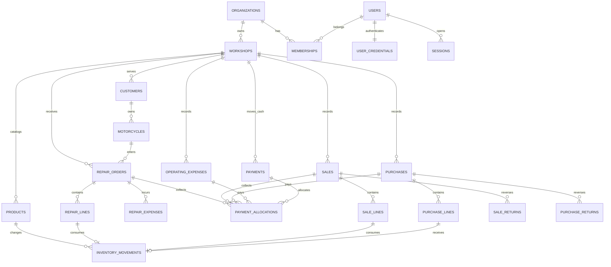

# Propuesta de base de datos: Zona Racing

## Alcance y decisiones

Esta propuesta transforma el estado local actual (clientes, motos, reparaciones, inventario, ventas, compras, gastos y configuración) en PostgreSQL con Drizzle ORM. La estructura se encuentra implementada en `src/db/schema.ts`, los clientes de servidor en `src/db/client.ts` y las migraciones se versionan en `drizzle/`. Las migraciones iniciales se aplicaron a la base Neon de desarrollo autorizada y se verificaron con pruebas PostgreSQL transaccionales cuyos datos fueron revertidos.

La primera instalación tendrá una organización y un taller. Sin embargo, las claves y las restricciones se diseñan desde el inicio para aislar negocios futuros (`organization_id`) y, después, permitir varios locales por negocio (`workshop_id`). Ninguna tabla de negocio debe depender implícitamente de un único taller global.

Principios:

- UUID para claves públicas y `timestamptz` en UTC para auditoría.
- `numeric(14,2)` para dinero en soles; nunca `float`.
- El precio final de una reparación puede ser `NULL`: pendiente de cotizar no equivale a S/ 0.00.
- Las cantidades de inventario se registran en un libro de movimientos inmutable; no se editan saldos históricos.
- Los importes, nombres y costos que llegan a un comprobante se guardan como *snapshot* para preservar la rentabilidad aunque luego cambie el catálogo.
- Toda escritura que afecte dinero, inventario y estado se realiza en una única transacción PostgreSQL.

## Conexiones Neon verificadas

El proyecto contiene, sin exponer sus valores, estas variables locales ignoradas por Git:

| Variable | Uso propuesto | No usar para |
| --- | --- | --- |
| `DATABASE_URL` | Tráfico de la aplicación Next.js, tanto consultas como transacciones operativas. Debe ser la URL con pooling. | Migraciones, `pg_dump`, replicación o cualquier operación administrativa que requiera conexión directa. |
| `DATABASE_URL_UNPOOLED` | Drizzle Kit y tareas administrativas puntuales: generar/aplicar migraciones, recuperación o mantenimiento. Debe ser la URL directa. | Tráfico normal serverless de Vercel. |

Neon recomienda el pooler para cargas serverless y conexiones por solicitud; su pool funciona en modo transaccional. Para migraciones y operaciones con estado de sesión se debe utilizar la conexión directa. Véase la documentación de [pooling de Neon](https://neon.com/docs/connect/connection-pooling) y la guía oficial de [Drizzle con Neon](https://orm.drizzle.team/docs/connect-neon).

Cuando se implemente:

```text
src/db/env.ts                -> valida DATABASE_URL sólo en el servidor
src/db/client.ts             -> dbQuery (HTTP) + dbTx (WebSocket)
src/db/schema.ts             -> tablas, enums y relaciones mediante claves foráneas de Drizzle
drizzle.config.ts            -> DATABASE_URL_UNPOOLED (Drizzle Kit)
drizzle/                     -> SQL generado y snapshots, versionados
```

### Controlador Neon: consultas y transacciones interactivas

Se utilizarán dos clientes de aplicación sobre la misma URL con pooling, con responsabilidades explícitas:

| Cliente futuro | Driver Drizzle | Uso |
| --- | --- | --- |
| `dbQuery` | `drizzle-orm/neon-http` | Lecturas, listados, reportes y escrituras simples de una sentencia. El HTTP driver es rápido para solicitudes independientes y *batch* atómico. |
| `dbTx` | `drizzle-orm/neon-serverless` con `Pool` de `@neondatabase/serverless` | Flujos interactivos `db.transaction(async (tx) => …)`: bloquear stock, emitir código, escribir varias tablas, validar pagos y confirmar/anular documentos. |

El segundo cliente es obligatorio para las operaciones críticas. El driver HTTP no mantiene sesión para una transacción interactiva; el driver WebSocket sí la mantiene. En el runtime Node de Vercel se configurará el constructor WebSocket con `ws` (y `bufferutil` si corresponde), tal como indica Drizzle. Las mutaciones que usan `dbTx` deben ejecutarse en runtime Node, no depender de estado global del proceso y liberar/administrar el pool conforme al ciclo de vida serverless.

Ejemplo **ilustrativo, no implementado**:

```ts
// src/db/transaction-client.ts — futuro
const pool = new Pool({ connectionString: process.env.DATABASE_URL });
export const dbTx = drizzle({ client: pool, schema });

await dbTx.transaction(async (tx) => {
  // secuencia, saldo, movimientos y documento: todo confirma o revierte junto
}, { isolationLevel: 'serializable', accessMode: 'read write' });
```

Los flujos de escritura críticos usarán `serializable` y reintentarán de forma limitada los conflictos transitorios (`40001`) o *deadlocks* (`40P01`), con una clave de idempotencia para que un reintento HTTP no duplique el efecto. No se harán llamadas a servicios externos, esperas de usuario ni procesamiento largo dentro de la transacción. `drizzle.config.ts` debe fallar temprano si falta `DATABASE_URL_UNPOOLED`. Ninguna variable se debe prefijar con `NEXT_PUBLIC_`, registrar en logs o incluir en ejemplos/documentación.

## Relación de módulos



## Tablas propuestas

### Núcleo y multiempresa

| Tabla | Campos esenciales | Reglas e índices |
| --- | --- | --- |
| `organizations` | `id`, `name`, `legal_name`, `tax_id`, `default_currency='PEN'`, `timezone='America/Lima'`, auditoría | `tax_id` único cuando exista. Es el límite de tenancy. |
| `workshops` | `id`, `organization_id`, `name`, dirección, teléfono, correo, horario, `is_active` | único `(organization_id, name)`. Se crea uno para Zona Racing. |
| `users` | `id`, nombre, username normalizado, correo opcional, `is_active` | username único global; correo opcional único cuando se proporciona. |
| `user_credentials` | `user_id`, `password_hash`, `password_changed_at`, `failed_attempts`, `locked_until` | una fila por usuario local; sólo se persiste el hash Argon2id. |
| `sessions` | `id`, `user_id`, `token_hash`, taller activo, expiración, revocación, último uso | tokens opacos revocables; índice por hash y expiración. |
| `memberships` | `organization_id`, `user_id`, `role`, `workshop_id` opcional | único `(organization_id, user_id)`; roles: administrador, jefe_taller, mecánico, caja. Sustituye los miembros demo y permite aislar negocios. |
| `audit_logs` | tenant, usuario opcional, acción, entidad, `entity_id`, metadatos seguros, fecha | append-only; no contiene contraseñas, tokens ni datos de conexión. |
| `document_sequences` | `workshop_id`, `document_type`, `year`, `last_value` | único `(workshop_id, document_type, year)`. Se bloquea en la misma transacción para generar `ZR-2026-001`, ventas y compras sin colisiones. |

Todo registro operativo incluye `organization_id`, `workshop_id`, `created_at`, `updated_at` y, cuando aplique, `created_by`. Aunque `organization_id` sea deducible por `workshop_id`, conservarlo facilita RLS, particionado futuro y validación de tenant; se valida que ambos pertenezcan al mismo negocio.

### Clientes y motocicletas

| Tabla | Campos esenciales | Reglas |
| --- | --- | --- |
| `customers` | `id`, tenant, `full_name`, teléfono, email, tipo/documento, notas, `is_active` | índice por `(workshop_id, full_name)` y teléfono. `document_number` único por organización sólo si no es nulo. |
| `motorcycles` | `id`, tenant, `customer_id`, marca, modelo, año, placa, VIN, cilindrada, color, kilometraje actual | placa única por taller cuando exista; VIN único por organización cuando exista. Año con `CHECK` razonable; kilometraje no negativo. |
| `motorcycle_ownership_history` (fase posterior) | `motorcycle_id`, `customer_id`, `started_at`, `ended_at` | No es necesaria para el flujo actual, pero evita perder historial si una moto cambia de dueño. |

Una reparación toma un snapshot de cliente, motocicleta, placa y kilometraje de ingreso. Por tanto, editar al cliente o la moto después no altera una orden histórica.

### Catálogo e inventario

| Tabla | Campos esenciales | Reglas |
| --- | --- | --- |
| `product_categories` | `id`, `workshop_id`, nombre | único `(workshop_id, normalized_name)`. |
| `products` | `id`, tenant, `sku`, nombre, marca, categoría, `sale_price`, `min_stock`, `is_active` | SKU único por taller. El costo vigente no es fuente de verdad histórica. |
| `stock_locations` | `id`, `workshop_id`, nombre, `is_default` | inicialmente una ubicación “Almacén principal”; permite más almacenes después. |
| `inventory_balances` | `product_id`, `stock_location_id`, `organization_id`, `workshop_id`, `quantity_on_hand`, `inventory_value`, `average_unit_cost`, `version` | PK compuesta por producto/ubicación y FKs compuestas tenant→taller, tenant→producto y taller→ubicación impiden cruces. Proyección bloqueada por fila. |
| `inventory_movements` | `id`, tenant, producto, ubicación, `movement_type`, `quantity_delta`, `unit_cost_applied`, `total_cost_applied`, saldo/valor antes y después, referencia única por línea de origen, `reverses_movement_id` | append-only; una sola reversión por movimiento fuente. Las líneas de venta/compra/reparación referencian un único movimiento y el índice único evita duplicar el asiento para una línea. |

`movement_type`: `purchase_receipt`, `repair_consumption`, `sale`, `sale_return`, `purchase_return`, `adjustment_in`, `adjustment_out`, `void_reversal`.

Para evitar inconsistencia, `quantity_on_hand` nunca se actualiza sin insertar el movimiento correspondiente. La transacción interactiva bloquea el balance `(product_id, stock_location_id)`, valida que una salida no deje stock negativo —salvo permiso explícito de venta/consumo pendiente—, inserta el ledger y actualiza el balance. La columna `version` permite detectar actualizaciones concurrentes.

El costo promedio ponderado se actualiza sólo al recibir inventario: `(valor anterior + costo real recibido) / (stock anterior + cantidad recibida)`. El promedio y costo unitario se guardan con seis decimales; el valor monetario extendido se redondea a centavos por movimiento con regla consistente. Cada salida conserva su costo aplicado, así una compra posterior no reescribe costos históricos. Una devolución de venta usa el costo snapshot de la salida original; una devolución a proveedor usa el costo histórico de recepción. Una transacción bloquea el balance por producto/ubicación y recalcula cantidad, valor y promedio conjuntamente.

### Reparaciones

| Tabla | Campos esenciales | Reglas |
| --- | --- | --- |
| `repair_orders` | `id`, tenant, código, cliente/moto, estado, problema reportado, diagnóstico, mecánico asignado, kilometraje ingreso, `quoted_total` nullable, entrega estimada nullable, fechas | único `(workshop_id, code)`. Precio `NULL` hasta cotizar. No permite `entregada` sin precio definido ni saldo pendiente salvo permiso de administrador. |
| `repair_status_history` | `repair_order_id`, estado previo/nuevo, observación, actor, fecha | se inserta por cada cambio; el estado de la orden es la proyección actual. |
| `repair_lines` | orden, tipo (`inventory_part`, `direct_part`, `customer_part`, `labor`, `other`), producto opcional, descripción snapshot, cantidad, costo/precio unitario, total, `inventory_movement_id` opcional | cantidades positivas. Para `inventory_part`, producto y movimiento son obligatorios y el movimiento es único. Para pieza aportada por cliente, costo de taller es 0. |
| `repair_expenses` | tenant, orden, `purchase_line_id` opcional, categoría, descripción, monto, fecha | no representa ingreso. Compra directa de repuesto se reconoce como costo desde la línea de compra o su gasto vinculado, nunca por ambas rutas; `purchase_line_id` es único y enlaza los pagos correspondientes. |

La orden puede ingresar sólo con cliente, moto y problema; repuestos, gastos, diagnóstico, precio y entrega estimada pueden añadirse después. Los precios y costos de `repair_lines` son snapshots y no se recalculan cuando cambia el producto.

### Ventas, compras y gastos

| Tabla | Campos esenciales | Reglas |
| --- | --- | --- |
| `sales` | tenant, código, cliente opcional, estado (`draft`, `completed`, `voided`), subtotal, descuento, total, fecha, caja/usuario, campos de anulación | único `(workshop_id, code)`. `completed` sólo se alcanza en transacción atómica. Una anulación conserva el documento y crea reversos. |
| `sale_lines` | venta, producto, SKU/nombre snapshot, cantidad, precio unitario, descuento, costo unitario snapshot | producto opcional sólo para servicios futuros; venta de inventario exige movimiento único de salida. |
| `sale_returns`, `sale_return_lines` | venta original, código, estado, motivo, fecha; línea original, cantidad, precio y costo snapshot | permiten devolución parcial. La cantidad devuelta no supera la neta vendida. Al confirmar, ingresan stock, reducen ingreso y crean/reasignan un reembolso. |
| `suppliers` | tenant, nombre, RUC opcional, contacto, activo | RUC único por organización si está presente. |
| `purchases` | tenant, código, proveedor, estado (`draft`, `ordered`, `received`, `cancelled`, `voided`), fecha, total, campos de anulación, notas | una compra puede alimentar almacén o atender una reparación. El saldo por pagar se deriva de sus asignaciones de pago. |
| `purchase_lines` | compra, producto opcional, descripción, cantidad, costo unitario, destino (`inventory`, `repair_direct`), reparación opcional | destino `inventory` genera ingreso sólo en `received`; `repair_direct` debe tener reparación y crea línea/costo de reparación, no stock general. |
| `purchase_returns`, `purchase_return_lines` | compra original, proveedor, motivo, fecha; línea original, cantidad y costo histórico | devolución parcial al proveedor. La cantidad no supera lo recibido menos lo ya devuelto; genera salida de inventario y disminuye la cuenta por pagar o habilita reembolso. |
| `operating_expenses` | tenant, categoría, beneficiario/proveedor, descripción, monto, fecha, centro de costo, estado, campos de anulación/reverso, notas | gastos generales: alquiler, nómina, servicios, herramientas. No se mezclan con compra de inventario ni costo de una reparación. |

### Cobros y rentabilidad

| Tabla | Campos esenciales | Reglas |
| --- | --- | --- |
| `payments` | tenant, dirección (`inbound`/`outbound`), método, monto, fecha, referencia externa, estado (`pending`, `confirmed`, `voided`, `reversed`), nota, `idempotency_key` | Es el movimiento de dinero. `inbound` cobra ventas/reparaciones o recibe devolución de proveedor; `outbound` paga compras/gastos o reembolsa clientes. |
| `payment_allocations` | `payment_id`, monto aplicado, exactamente un destino: reparación, venta, compra, compra directa, gasto de reparación o gasto operativo | `CHECK` de exactamente un destino. Permite pagos parciales y repartidos. La suma confirmada debe corresponder al pago; servicios transaccionales validan saldo, dirección y pertenencia al tenant. |
| `payment_methods` | tenant, código, etiqueta, activo, referencia de cuenta | configura sólo efectivo, Yape, Plin y transferencia. El registro es manual: no hay POS, pasarela, API bancaria ni secreto de proveedor. |
| `cash_movements` (fase posterior) | caja, tipo, monto, origen de pago/gasto, fecha | necesario si se gestiona arqueo de caja; no es requisito de la primera migración. |

Las vistas de rentabilidad se derivan, no se editan:

- **Venta**: neto confirmado de `sale_lines`, menos costo snapshot de sus líneas, menos devoluciones/anulaciones efectivas del periodo.
- **Reparación**: precio cotizado o líneas facturables menos costos snapshot de `repair_lines` y `repair_expenses`. Si `quoted_total IS NULL`, margen y saldo deben ser `NULL`/“por definir”, no cero.
- **Resultado operativo devengado por periodo**: ingresos y costos de documentos confirmados en su fecha efectiva, menos gastos operativos confirmados; las compras de inventario no son gasto operativo al recibirlas, sino costo cuando ese inventario se consume/vende.
- **Flujo de caja por periodo**: `payments.inbound` confirmados menos `payments.outbound` confirmados. No debe confundirse con rentabilidad devengada.

## Restricciones y transacciones de negocio

1. **Aislamiento de tenant.** Cada FK de negocio debe apuntar a registros del mismo `organization_id`/`workshop_id` mediante claves únicas compuestas en padres y FKs compuestas en hijos. En SaaS, activar además RLS; los servicios verifican membership en todo caso.
2. **Estado de reparación.** Sólo se permiten las transiciones definidas: `recibida → diagnostico → en_proceso/esperando_repuesto → lista → entregada`, con retrocesos auditados. Cancelar o revertir una orden crea reversiones de inventario; no borra líneas ni pagos.
3. **Pagos y cuentas por cobrar/pagar.** Un pago no puede ser negativo ni confirmarse sin que sus asignaciones sumen su importe. Los pagos de compra y gasto son `outbound`; los cobros de venta/reparación son `inbound`. El saldo de cada documento se deriva de asignaciones confirmadas, no se captura manualmente.
4. **Anulaciones y devoluciones.** Un documento confirmado nunca se elimina. `voided_at`, `voided_by`, `void_reason` y el documento/reverso relacionado son obligatorios. La anulación revierte stock y margen sólo una vez; si ya hubo pago, requiere reembolso, nota de crédito o una excepción auditada. Las devoluciones parciales sólo pueden referenciar líneas confirmadas y no superar su cantidad neta disponible.
5. **Stock.** Completar una venta o consumir una línea de reparación bloquea el balance, valida disponibilidad y genera exactamente un movimiento. Anular o devolver genera un movimiento inverso, nunca borra el original. El promedio ponderado sólo se recalcula en entradas de costo real; los costos históricos de salida permanecen inmutables.
6. **Compras.** Sólo una compra `received` afecta inventario. Una compra directa para una reparación se vincula a la orden y al costo de la línea, para evitar doble contabilidad como gasto general e inventario. Sus pagos parciales se registran en `payments` + `payment_allocations`.
7. **Gastos.** Un gasto operativo puede estar pendiente, parcialmente pagado, pagado, anulado o revertido. El pago se registra aparte y se asigna al gasto; no se usa un booleano `paid` editable.
8. **Importes.** Totales de ventas, compras y órdenes se calculan en el servidor/DB desde líneas; los valores enviados por el cliente son de referencia, no fuente de verdad.
9. **Identificadores de negocio.** Los códigos ZR/V/CG se emiten desde `document_sequences` dentro de la transacción. No derivarlos del número de filas, que falla con concurrencia y anulaciones.
10. **Auditoría.** Conservar `created_at`, `updated_at`, usuario actor e historial de estados/movimientos. Toda edición posterior a una confirmación se registra como ajuste o reversión.

### Operaciones que exigen `dbTx`

| Operación | Secuencia atómica mínima |
| --- | --- |
| Confirmar venta | bloquear balances → validar stock → emitir código → insertar venta/líneas/costo snapshot → descontar inventario → crear cobro/asignación opcional → confirmar. |
| Consumir repuesto en reparación | bloquear balance → validar disponibilidad → insertar `repair_line` → salida de inventario con costo promedio snapshot → actualizar balance. |
| Recibir compra | bloquear balances por línea → insertar recepción/movimientos → recalcular promedio ponderado → actualizar compra/saldo por pagar. |
| Registrar pago | insertar pago con `idempotency_key` → validar documento y saldo → insertar asignación → confirmar. |
| Anular/devolver | bloquear documento y línea/balance → validar saldo/cantidad no revertida → insertar reverso/devolución y movimiento inverso → crear reembolso o saldo a favor si corresponde. |

## Autenticación inicial y aislamiento simple

La primera versión puede resolver autenticación sin introducir SSO, invitaciones públicas ni una plataforma externa:

1. Login por nombre de usuario y contraseña administrado por el taller; el correo es opcional y no hay auto-registro público.
2. `users` contiene identidad y estado; `user_credentials` guarda únicamente `password_hash` Argon2id, fecha de cambio y contador/fecha de bloqueo. Nunca contraseña, token o PIN en texto plano.
3. `sessions` almacena `token_hash`, `user_id`, organización/taller activo, expiración, revocación y último uso. La cookie contiene un token opaco aleatorio, `HttpOnly`, `Secure`, `SameSite=Lax` y prefijo `__Host-` en producción.
4. El contexto de cada solicitud se obtiene en el servidor desde la sesión y su `membership`; el cliente nunca decide `organization_id`, `workshop_id` ni rol.
5. Se crea manualmente el primer administrador de Zona Racing. Los demás usuarios se crean desde una pantalla interna posterior. Incluir límite de intentos de login y `audit_logs` de acceso/acciones sensibles.

Esta estructura basta para un taller y reutiliza `memberships` cuando se agreguen otros negocios. La protección RLS de PostgreSQL puede activarse en una fase SaaS posterior; hasta entonces, los servicios de servidor aplican siempre el contexto de sesión y las FKs compuestas evitan cruzar tenants.

## Mapeo desde el frontend actual

| Estado actual | Persistencia objetivo |
| --- | --- |
| `Customer`, `Motorcycle` | `customers`, `motorcycles` |
| `Product`, `InventoryMovement` | `products`, `inventory_balances`, `inventory_movements` |
| `RepairOrder`, partes, gastos, abonos | `repair_orders`, `repair_lines`, `repair_expenses`, `payments`, `payment_allocations`, `repair_status_history` |
| `Sale`, `SaleItem` | `sales`, `sale_lines`, `sale_returns`, `payments`, `payment_allocations`, `inventory_movements` |
| `PurchaseOrExpense` | `purchases` + `purchase_lines` + `purchase_returns`, u `operating_expenses`, según origen; sus pagos usan `payments` + `payment_allocations` |
| `WorkshopSettings`, equipo, acceso y métodos de pago | `workshops`, `users`, `memberships`, `sessions`, `payment_methods` |

La migración posterior debe importar los datos demo una sola vez mediante un script idempotente de desarrollo, no al iniciar la aplicación. Los nombres de imagen pueden mantenerse como rutas de objetos/archivos; no guardar binarios en estas tablas.

## Implementación futura, en orden seguro

1. Completado: añadir Drizzle, `@neondatabase/serverless`, `ws`, Drizzle Kit, esquema, clientes `dbQuery`/`dbTx` y las migraciones iniciales. Validar con `npm run db:check`; `npm run db:generate` regenera SQL sin aplicarlo.
2. Completado: aplicar las migraciones iniciales a la rama Neon autorizada temporalmente para desarrollo; validar relaciones e invariantes con `npm run db:verify:postgres`, que usa una transacción y revierte todos los fixtures.
3. Implementar repositorios y servicios de servidor con `DATABASE_URL`; migrar primero clientes/motos y catálogo, luego inventario, reparaciones y finalmente ventas/finanzas.
4. Reemplazar el contexto demo por llamadas a servidor conservando las validaciones de interfaz; agregar pruebas transaccionales para concurrencia de stock, anulaciones, devoluciones y pagos duplicados.

## Fuentes técnicas

- [Drizzle ORM: conexión con Neon](https://orm.drizzle.team/docs/connect-neon)
- [Drizzle ORM: transacciones](https://orm.drizzle.team/docs/transactions)
- [Drizzle Kit: archivo de configuración](https://orm.drizzle.team/docs/drizzle-config-file)
- [Neon: connection pooling](https://neon.com/docs/connect/connection-pooling)
