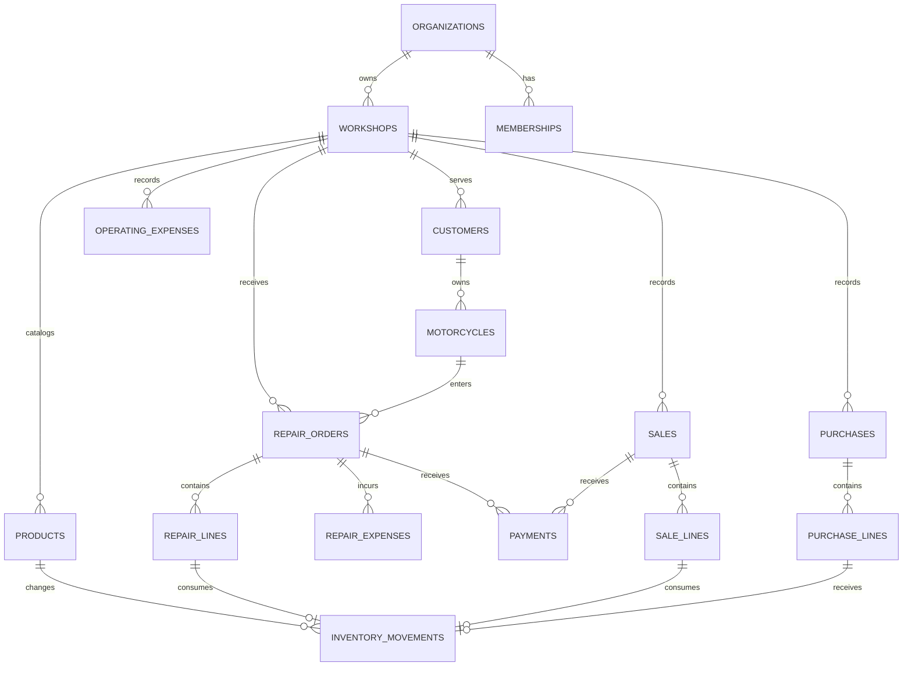

# Propuesta de base de datos: Zona Racing

## Alcance y decisiones

Esta propuesta transforma el estado local actual (clientes, motos, reparaciones, inventario, ventas, compras, gastos y configuración) en PostgreSQL con Drizzle ORM. Es un diseño de referencia: **no agrega dependencias, no crea archivos de Drizzle, no genera migraciones y no se conecta a Neon**.

La primera instalación tendrá una organización y un taller. Sin embargo, las claves y las restricciones se diseñan desde el inicio para aislar negocios futuros (`organization_id`) y, después, permitir varios locales por negocio (`workshop_id`). Ninguna tabla de negocio debe depender implícitamente de un único taller global.

Principios:

- UUID para claves públicas y `timestamptz` en UTC para auditoría.
- `numeric(14,2)` para dinero en soles; nunca `float`.
- El precio final de una reparación puede ser `NULL`: pendiente de cotizar no equivale a S/ 0.00.
- Las cantidades de inventario se registran en un libro de movimientos inmutable; no se editan saldos históricos.
- Los importes, nombres y costos que llegan a un comprobante se guardan como *snapshot* para preservar la rentabilidad aunque luego cambie el catálogo.
- Toda escritura que afecte dinero, inventario y estado se realiza en una única transacción PostgreSQL.

## Conexiones Neon verificadas

El proyecto contiene, sin exponer sus valores, estas variables locales ignoradas por Git:

| Variable | Uso propuesto | No usar para |
| --- | --- | --- |
| `DATABASE_URL` | Tráfico normal de la aplicación Next.js: consultas y transacciones cortas desde Server Actions, Route Handlers o servicios de servidor. Debe ser la URL con pooling. | Migraciones, `pg_dump`, replicación o cualquier operación que dependa de estado de sesión. |
| `DATABASE_URL_UNPOOLED` | Drizzle Kit y tareas administrativas puntuales: generar/aplicar migraciones, recuperación o mantenimiento. Debe ser la URL directa. | Tráfico normal serverless de Vercel. |

Neon recomienda el pooler para cargas serverless y conexiones por solicitud; su pool funciona en modo transaccional. Para migraciones y operaciones con estado de sesión se debe utilizar la conexión directa. Véase la documentación de [pooling de Neon](https://neon.com/docs/connect/connection-pooling) y la guía oficial de [Drizzle con Neon](https://orm.drizzle.team/docs/get-started/neon-new).

Cuando se implemente:

```text
src/db/client.ts             -> Drizzle + DATABASE_URL (aplicación)
src/db/schema/*.ts           -> tablas, enums y relations de Drizzle
drizzle.config.ts            -> DATABASE_URL_UNPOOLED (Drizzle Kit)
drizzle/                     -> SQL generado y snapshots, versionados
```

El cliente de aplicación puede usar `drizzle-orm/neon-http` con `@neondatabase/serverless` para consultas serverless. El archivo `drizzle.config.ts` debe fallar temprano si falta `DATABASE_URL_UNPOOLED`. Ninguna variable se debe prefijar con `NEXT_PUBLIC_`, registrar en logs o incluir en ejemplos/documentación.

## Relación de módulos



## Tablas propuestas

### Núcleo y multiempresa

| Tabla | Campos esenciales | Reglas e índices |
| --- | --- | --- |
| `organizations` | `id`, `name`, `legal_name`, `tax_id`, `default_currency='PEN'`, `timezone='America/Lima'`, auditoría | `tax_id` único cuando exista. Es el límite de tenancy. |
| `workshops` | `id`, `organization_id`, `name`, dirección, teléfono, correo, horario, `is_active` | único `(organization_id, name)`. Se crea uno para Zona Racing. |
| `users` | `id`, nombre, correo normalizado, `is_active` | correo único global si hay autenticación compartida. |
| `memberships` | `organization_id`, `user_id`, `role`, `workshop_id` opcional | único `(organization_id, user_id)`; roles: administrador, jefe_taller, mecánico, caja. Sustituye los miembros demo y permite aislar negocios. |
| `document_sequences` | `workshop_id`, `document_type`, `year`, `last_value` | único `(workshop_id, document_type, year)`. Se bloquea en la misma transacción para generar `ZR-2026-001`, ventas y compras sin colisiones. |

Todo registro operativo incluye `organization_id`, `workshop_id`, `created_at`, `updated_at` y, cuando aplique, `created_by`. Aunque `organization_id` sea deducible por `workshop_id`, conservarlo facilita RLS, particionado futuro y validación de tenant; se valida que ambos pertenezcan al mismo negocio.

### Clientes y motocicletas

| Tabla | Campos esenciales | Reglas |
| --- | --- | --- |
| `customers` | `id`, tenant, `full_name`, teléfono, email, tipo/documento, notas, `is_active` | índice por `(workshop_id, full_name)` y teléfono. `document_number` único por organización sólo si no es nulo. |
| `motorcycles` | `id`, tenant, `customer_id`, marca, modelo, año, placa, VIN, cilindrada, color, kilometraje actual | placa única por taller cuando exista; VIN único por organización cuando exista. Año con `CHECK` razonable; kilometraje no negativo. |
| `motorcycle_ownership_history` (fase posterior) | `motorcycle_id`, `customer_id`, `started_at`, `ended_at` | No es necesaria para el flujo actual, pero evita perder historial si una moto cambia de dueño. |

Una reparación toma un snapshot de cliente, motocicleta, placa y kilometraje de ingreso. Por tanto, editar al cliente o la moto después no altera una orden histórica.

### Catálogo e inventario

| Tabla | Campos esenciales | Reglas |
| --- | --- | --- |
| `product_categories` | `id`, `workshop_id`, nombre | único `(workshop_id, normalized_name)`. |
| `products` | `id`, tenant, `sku`, nombre, marca, categoría, `sale_price`, `min_stock`, `is_active` | SKU único por taller. El costo vigente no es fuente de verdad histórica. |
| `stock_locations` | `id`, `workshop_id`, nombre, `is_default` | inicialmente una ubicación “Almacén principal”; permite más almacenes después. |
| `inventory_balances` | `product_id`, `stock_location_id`, `quantity_on_hand`, `average_unit_cost`, `version` | PK compuesta. Es una proyección de lectura; se actualiza junto con el movimiento bajo bloqueo de fila. |
| `inventory_movements` | `id`, tenant, producto, ubicación, `movement_type`, `quantity_delta`, costo unitario, saldo anterior/posterior, motivo, referencia, autor, fecha | append-only. Índices por producto/fecha y referencia. No se borra ni edita: las correcciones son otro movimiento de ajuste o reversión. |

`movement_type`: `purchase_receipt`, `repair_consumption`, `sale`, `adjustment_in`, `adjustment_out`, `return_in`, `return_out`, `void_reversal`.

Para evitar inconsistencia, `quantity_on_hand` nunca se actualiza sin insertar el movimiento correspondiente. La transacción bloquea el balance `(product_id, stock_location_id)`, valida que una salida no deje stock negativo —salvo permiso explícito de venta/consumo pendiente—, inserta el ledger y actualiza el balance. La columna `version` permite detectar actualizaciones concurrentes.

### Reparaciones

| Tabla | Campos esenciales | Reglas |
| --- | --- | --- |
| `repair_orders` | `id`, tenant, código, cliente/moto, estado, problema reportado, diagnóstico, mecánico asignado, kilometraje ingreso, `quoted_total` nullable, entrega estimada nullable, fechas | único `(workshop_id, code)`. Precio `NULL` hasta cotizar. No permite `entregada` sin precio definido ni saldo pendiente salvo permiso de administrador. |
| `repair_status_history` | `repair_order_id`, estado previo/nuevo, observación, actor, fecha | se inserta por cada cambio; el estado de la orden es la proyección actual. |
| `repair_lines` | orden, tipo (`inventory_part`, `direct_part`, `customer_part`, `labor`, `other`), producto opcional, descripción snapshot, cantidad, costo/precio unitario, total, `inventory_movement_id` opcional | cantidades positivas. Para `inventory_part`, producto y movimiento son obligatorios y el movimiento es único. Para pieza aportada por cliente, costo de taller es 0. |
| `repair_expenses` | orden, proveedor opcional, categoría, descripción, monto, fecha, adjunto futuro | no representa ingreso y se cuenta como costo directo de esa reparación. |

La orden puede ingresar sólo con cliente, moto y problema; repuestos, gastos, diagnóstico, precio y entrega estimada pueden añadirse después. Los precios y costos de `repair_lines` son snapshots y no se recalculan cuando cambia el producto.

### Ventas, compras y gastos

| Tabla | Campos esenciales | Reglas |
| --- | --- | --- |
| `sales` | tenant, código, cliente opcional, estado (`draft`, `completed`, `voided`), subtotal, descuento, total, fecha, caja/usuario | único `(workshop_id, code)`. `completed` sólo se alcanza en transacción atómica. |
| `sale_lines` | venta, producto, SKU/nombre snapshot, cantidad, precio unitario, descuento, costo unitario snapshot | producto opcional sólo para servicios futuros; venta de inventario exige movimiento único de salida. |
| `suppliers` | tenant, nombre, RUC opcional, contacto, activo | RUC único por organización si está presente. |
| `purchases` | tenant, código, proveedor, estado (`draft`, `ordered`, `received`, `cancelled`), fecha, total, notas | una compra puede alimentar almacén o atender una reparación. |
| `purchase_lines` | compra, producto opcional, descripción, cantidad, costo unitario, destino (`inventory`, `repair_direct`), reparación opcional | destino `inventory` genera ingreso sólo en `received`; `repair_direct` debe tener reparación y crea línea/costo de reparación, no stock general. |
| `operating_expenses` | tenant, categoría, beneficiario/proveedor, descripción, monto, fecha, centro de costo, notas | gastos generales: alquiler, nómina, servicios, herramientas. No se mezclan con compra de inventario ni costo de una reparación. |

### Cobros y rentabilidad

| Tabla | Campos esenciales | Reglas |
| --- | --- | --- |
| `payments` | tenant, método, monto, fecha, referencia externa, nota, `repair_order_id` nullable, `sale_id` nullable, `status` | `CHECK` que exactamente uno de `repair_order_id` o `sale_id` sea no nulo. `idempotency_key` único por taller para evitar doble cobro desde UI/reintentos. |
| `payment_methods` | tenant, código, etiqueta, activo, datos de cuenta cifrables | configura efectivo, Yape/Plin, tarjeta y transferencia sin almacenar secretos en texto plano. |
| `cash_movements` (fase posterior) | caja, tipo, monto, origen de pago/gasto, fecha | necesario si se gestiona arqueo de caja; no es requisito de la primera migración. |

Las vistas de rentabilidad se derivan, no se editan:

- **Venta**: neto de `sale_lines` menos costo snapshot de sus líneas.
- **Reparación**: precio cotizado menos costos de `repair_lines` y `repair_expenses`. Si `quoted_total IS NULL`, margen y saldo deben ser `NULL`/“por definir”, no cero.
- **Resultado operativo**: margen de ventas y reparaciones menos `operating_expenses` del periodo.
- **Flujo de caja**: suma de `payments` menos pagos de compras/gastos cuando se incorpore su conciliación. No debe confundirse con rentabilidad devengada.

## Restricciones y transacciones de negocio

1. **Aislamiento de tenant.** Cada FK de negocio debe apuntar a registros del mismo `organization_id`/`workshop_id`. En la etapa SaaS, activar RLS con `organization_id` tomado de la sesión autenticada; hasta entonces, imponerlo en servicios de servidor y restricciones compuestas.
2. **Estado de reparación.** Sólo se permiten las transiciones definidas: `recibida → diagnostico → en_proceso/esperando_repuesto → lista → entregada`, con retrocesos auditados. Cancelar o revertir una orden crea reversiones de inventario; no borra líneas ni pagos.
3. **Precio y pagos.** Un pago no puede ser negativo. La suma de pagos confirmados no puede exceder el importe final sin una autorización/nota de crédito. No registrar una entrega si no hay precio final y sin una excepción auditada.
4. **Stock.** Completar una venta o consumir una línea de reparación bloquea el balance, valida disponibilidad y genera exactamente un movimiento. Anular genera un movimiento inverso, nunca borra el original.
5. **Compras.** Sólo una compra `received` afecta inventario. Una compra directa para una reparación se vincula a la orden y al costo de la línea, para evitar doble contabilidad como gasto general e inventario.
6. **Importes.** Totales de ventas, compras y órdenes se calculan en el servidor/DB desde líneas; los valores enviados por el cliente son de referencia, no fuente de verdad.
7. **Identificadores de negocio.** Los códigos ZR/V/CG se emiten desde `document_sequences` dentro de la transacción. No derivarlos del número de filas, que falla con concurrencia y anulaciones.
8. **Auditoría.** Conservar `created_at`, `updated_at`, usuario actor e historial de estados/movimientos. Toda edición posterior a una confirmación se registra como ajuste o reversión.

## Mapeo desde el frontend actual

| Estado actual | Persistencia objetivo |
| --- | --- |
| `Customer`, `Motorcycle` | `customers`, `motorcycles` |
| `Product`, `InventoryMovement` | `products`, `inventory_balances`, `inventory_movements` |
| `RepairOrder`, partes, gastos, abonos | `repair_orders`, `repair_lines`, `repair_expenses`, `payments`, `repair_status_history` |
| `Sale`, `SaleItem` | `sales`, `sale_lines`, `payments`, `inventory_movements` |
| `PurchaseOrExpense` | `purchases` + `purchase_lines` o `operating_expenses`, según origen |
| `WorkshopSettings`, equipo y métodos de pago | `workshops`, `memberships`, `payment_methods` |

La migración posterior debe importar los datos demo una sola vez mediante un script idempotente de desarrollo, no al iniciar la aplicación. Los nombres de imagen pueden mantenerse como rutas de objetos/archivos; no guardar binarios en estas tablas.

## Implementación futura, en orden seguro

1. Añadir Drizzle, Neon serverless driver y Drizzle Kit, sin cambiar componentes cliente todavía.
2. Declarar enums/tablas en módulos de esquema y relations de Drizzle; añadir `drizzle.config.ts` que use exclusivamente `DATABASE_URL_UNPOOLED`.
3. Revisar el SQL generado, restricciones, índices y políticas de tenant en un entorno Neon de desarrollo.
4. Aplicar la primera migración manualmente y registrar el procedimiento de rollback. No ejecutar `push` sobre producción.
5. Implementar repositorios y servicios de servidor con `DATABASE_URL`; migrar primero clientes/motos y catálogo, luego inventario, reparaciones y finalmente ventas/finanzas.
6. Reemplazar el contexto demo por llamadas a servidor conservando las validaciones de interfaz; agregar pruebas transaccionales para concurrencia de stock, anulaciones y pagos duplicados.

## Fuentes técnicas

- [Drizzle ORM: conexión con Neon](https://orm.drizzle.team/docs/get-started/neon-new)
- [Drizzle Kit: archivo de configuración](https://orm.drizzle.team/docs/drizzle-config-file)
- [Neon: connection pooling](https://neon.com/docs/connect/connection-pooling)
